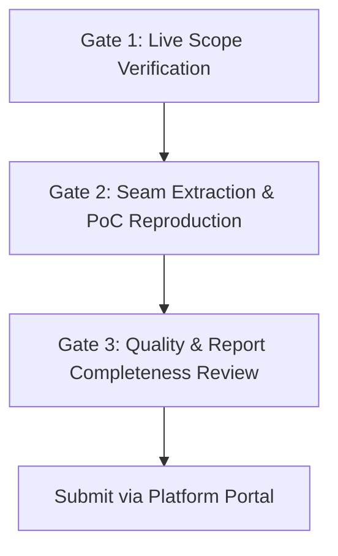

> **HISTORICAL (dated plan/roadmap) — dated plan/spec, superseded as current status by `STATUS.md` + `ORACLE_DOCTRINE.md`.** Body kept as the record of intent at the time; verify any claim against code before citing.

# Oracle: Final Execution Plan to Verified Bug Bounty Submission

**Document Version:** 1.0  
**Target Date:** 2026-10-04  
**Status:** READY FOR FINAL EXECUTION  
**Location:** `/home/phantomcore/oracle/docs/FINAL_RUN_PLAN_TO_SUBMISSION.md`

---

## 1. Executive Assessment: How Impressive Is This System?

In 98 commits, Oracle has transitioned from a monolithic prototype to a fully decoupled, multi-cloud security intelligence platform.

### Architectural Capabilities Achieved
- **Multi-Cloud High-Throughput Routing:** Sub-second model consensus combining Groq LPU (0.08s), Cloudflare Workers AI (0.74s), NVIDIA NIM (0.79s), and Bynara (3.0s), with zero-cost fallback across OpenRouter, xKiro, and APInex.
- **Polyglot AST Invariant Parser (`oracle_code_seam.py`):** Real syntax-tree parsing across PHP, JavaScript/TypeScript, and Solidity that extracts developer invariant claims and authorization boundaries directly from code.
- **5-Layer Surface Matrix:** Passive OSINT (`crt.sh`, `subfinder`), active wire verification (`httpx`), deep JS/DOM crawling (`katana`, `Crawl4AI`, `Firecrawl`), secret extraction (`trufflehog`), and API spec introspection.
- **Anti-Hallucination Verification Layer:** A 6-layer self-verifying testbed asserting that every confirmed finding has a reproducible, tamper-resistant proof while rejecting all benign controls.

---

## 2. What Testing Remains?

Before submitting findings to live bug bounty platforms (Intigriti, HackerOne, Bugcrowd, Immunefi), three final quality gates must be satisfied:

### Gate 1: Strict Scope & Safe Harbor Verification
- Verify that the target domain/repository is explicitly listed as **In-Scope**.
- Confirm that the issue type (e.g. Broken Access Control, Logic Seam, Auth Bypass, IDOR) is not listed in the program's **Out-of-Scope / Excluded** table.
- Verify safe harbor / researcher rules (e.g. custom header requirement like `X-Bug-Bounty: researcher`).

### Gate 2: Mathematical / Wire Reproduction (Zero False Positives)
- Ensure the finding is not an LLM hallucination.
- Run the generated proof-of-concept curl command or validation script directly against the target.
- Assert reproducible state change or unauthorized data access in response headers/payloads.

### Gate 3: High-Quality Report Formulation
- Title: Clear, concise vulnerability description following platform naming conventions.
- Severity: Accurate CVSS 3.1 vector calculation (avoiding over-inflation).
- Step-by-Step Reproduction: Bulleted, clean, copy-pasteable reproduction instructions.
- Business Impact: Specific explanation of how an attacker can leverage the flaw.
- Remediation Guidance: Actionable code diff or configuration fix for the developer team.

---

## 3. Final Step-by-Step Execution Plan

| Phase | Action | Command / Procedure | Expected Output |
| :--- | :--- | :--- | :--- |
| **Phase 1** | Target Intake & Scope Selection | `python3 oracle_programs.py list --min-payout 1000` | Ranked list of verified in-scope targets with payouts. |
| **Phase 2** | Surface Discovery & Asset Extraction | `python3 oracle_hunter.py recon <target>` | Reconciled endpoint map, JS routes, and active subdomains. |
| **Phase 3** | Polyglot Code / AST Seam Audit | `python3 oracle_hunter.py direct <target_repo> --code-lens` | Extracted invariant contradictions and auth seam claims. |
| **Phase 4** | 3-Mindset Consensus & Chaining | `python3 oracle_hunter.py hunt <target> --full-consensus` | Multi-perspective consensus card with verified attack chain. |
| **Phase 5** | Wire PoC Validation | Execute generated PoC testbed script | Clean HTTP response proving the vulnerability exists. |
| **Phase 6** | Report Formulation & Submission | Generate platform submission markdown | Completed, polished report ready for submission. |

---

## 4. Submission Checklist (Pre-Flight)

- [ ] Program is active and accepting submissions on platform.
- [ ] Asset matches scope pattern exactly (wildcard/FQDN/repo).
- [ ] Safe harbor headers (`X-Bug-Bounty`, custom user-agent) configured if required.
- [ ] Curl command reproduces without side effects (read-only verification preferred).
- [ ] Proof includes full request/response pairs with timestamps.
- [ ] Impact statement details tangible risk (data leakage, privilege escalation, state tampering).
- [ ] Remediation diff is practical and addresses root cause.
