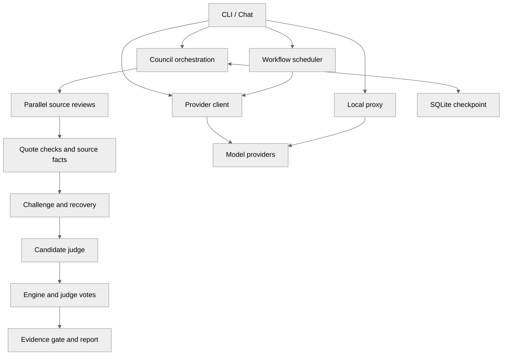

> **HISTORICAL EXPORT — dated Greptile review snapshot; superseded by subsequent refactors. Do not cite as current architecture.**

<!-- greptile_summary -->

<h2><a href="https://app.greptile.com/api/retrigger?id=80484951"><picture><source media="(prefers-color-scheme: dark)" srcset="https://greptile-static-assets.s3.amazonaws.com/badges/RetriggerDark.svg?v=2"><source media="(prefers-color-scheme: light)" srcset="https://greptile-static-assets.s3.amazonaws.com/badges/Retrigger.svg?v=2"></picture></a>Confidence Score: 0/5</h2>

**[Medium impact]** Adds a new multi\-model AI agent and CLI tool\.

This source would need fixes before a merge, especially for proxy access, saved key permissions, and local-host authorization.

<h2>Findings</h2>

1. &nbsp;&nbsp;**Proxy accepts unchecked callers** <a href="https://github.com/code-hunter-extreme/omnicli/pull/1#discussion_r4267675913">▶</a>
2. &nbsp;**Failed streams look successful** <a href="https://github.com/code-hunter-extreme/omnicli/pull/1#discussion_r4267675926">▶</a>
3. &nbsp;&nbsp;**Saved keys can be readable** <a href="https://github.com/code-hunter-extreme/omnicli/pull/1#discussion_r4267675934">▶</a>
4. &nbsp;**Separate configurations share settings** <a href="https://github.com/code-hunter-extreme/omnicli/pull/1#discussion_r4267675948">▶</a>
5. &nbsp;**Custom roots still share files** <a href="https://github.com/code-hunter-extreme/omnicli/pull/1#discussion_r4267675960">▶</a>
6. &nbsp;**Council chat forgets prior turns** <a href="https://github.com/code-hunter-extreme/omnicli/pull/1#discussion_r4267675968">▶</a>
7. &nbsp;**Council ignores system instructions** <a href="https://github.com/code-hunter-extreme/omnicli/pull/1#discussion_r4267675979">▶</a>
8. &nbsp;**Scores name the wrong model** <a href="https://github.com/code-hunter-extreme/omnicli/pull/1#discussion_r4267675994">▶</a>
9. &nbsp;**Protected routes get false findings** <a href="https://github.com/code-hunter-extreme/omnicli/pull/1#discussion_r4267676001">▶</a>
10. &nbsp;**Judge outages inflate clean scores** <a href="https://github.com/code-hunter-extreme/omnicli/pull/1#discussion_r4267676010">▶</a>
11. &nbsp;**Resume ignores changed settings** <a href="https://github.com/code-hunter-extreme/omnicli/pull/1#discussion_r4267676019">▶</a>
12. &nbsp;**Successful recovery crashes the run** <a href="https://github.com/code-hunter-extreme/omnicli/pull/1#discussion_r4267676032">▶</a>
13. &nbsp;&nbsp;**Local probes bypass authorized hosts** <a href="https://github.com/code-hunter-extreme/omnicli/pull/1#discussion_r4267676073">▶</a>
14. &nbsp;**Council history is not saved** <a href="https://github.com/code-hunter-extreme/omnicli/pull/1#discussion_r4267675985">▶</a>
15. &nbsp;**Incomplete audits look completed** <a href="https://github.com/code-hunter-extreme/omnicli/pull/1#discussion_r4267676038">▶</a>
16. &nbsp;**Slow tasks delay ready children** <a href="https://github.com/code-hunter-extreme/omnicli/pull/1#discussion_r4267676047">▶</a>
17. &nbsp;**Stage deadlines are not enforced** <a href="https://github.com/code-hunter-extreme/omnicli/pull/1#discussion_r4267676052">▶</a>
18. &nbsp;**Resume repeats completed model calls** <a href="https://github.com/code-hunter-extreme/omnicli/pull/1#discussion_r4267676061">▶</a>
19. &nbsp;**Invalid commands spend quota first** <a href="https://github.com/code-hunter-extreme/omnicli/pull/1#discussion_r4267676069">▶</a>

<details><summary>Fix with agent prompt</summary>

`````markdown
### Issue 1
omnicli/proxy.py:111-114
If the operator runs `omni serve --host 0.0.0.0`, anyone who can reach the port can choose a provider and spend its quota. `chat_completions` adds the operator’s stored keys without checking the caller. Wildcard CORS also permits cross-origin callers. Require a proxy access token before forwarding and restrict allowed origins.

**How this was verified:** The public request handler reads the operator’s stored key and forwards the caller’s request without an authentication check.

### Issue 2
omnicli/proxy.py:153-158
`sse_generator` never checks the upstream status. An upstream 401, 429, or 500 becomes a local HTTP 200 stream containing raw error text instead of valid SSE events. Clients lose the failure status and may return an empty answer. Open the upstream response before returning `StreamingResponse` and forward failures with their status.

### Issue 3
omnicli/config.py:282-283
If the operator uses a 022 umask and a readable home directory, another local user can read saved API keys. `_save` creates `config.json` with ordinary file permissions and never restricts access. Create the file owner-only and tighten permissions on existing files before saving.

**How this was verified:** `set_api_key` stores the credential in the saved dictionary, and `_save` writes it through ordinary `open` without restricting file permissions.

### Issue 4
omnicli/config.py:221
`dict(DEFAULT_PROVIDERS)` copies only the outer dictionary. Two fresh `ConfigManager` instances share each provider’s settings, so `set_default_model` or `save_scan_results` on one changes the other and the defaults used by later instances. Deep-copy the nested defaults, including `DEFAULT_MEMORY`, when creating a configuration.

### Issue 5
omnicli/config.py:227-228
A custom `config_dir` does not move the memory or heartbeat defaults. They still point into `~/.config/omnicli`, so `write_status` can overwrite the standalone CLI’s heartbeat file. Enabled history can also share transcripts between otherwise separate callers. Build these default paths from `self.config_dir`.

### Issue 6
omnicli/chat.py:593
Default `collaborate` chat passes only the latest prompt to `run_orchestration`, not the conversation in `self.messages`. A follow-up such as “revise your last answer” reaches every member without the answer being revised. Pass previous turns through the council call while preserving their roles.

### Issue 7
omnicli/chat.py:589-599
The `collaborate` branch omits the `system` argument. `/system`, `--system`, and memory added by `_apply_memory` only update `self.messages[0]`, which this branch never sends. The default chat mode therefore ignores those instructions. Pass the composed system message through the existing `system` parameter.

### Issue 8
omnicli/client.py:378-383
When an explicitly requested model returns `model_not_found`, this retry silently replaces it with the configured default. `evaluate_security_models` then scores the default’s answer under the requested model’s name; swarm results are mislabeled too. Do not silently substitute an explicit model, or return and propagate the actual model used. The streaming retry has the same problem.

### Issue 9
omnicli/evidence.py:259-263
`request_hooks` records never include `enforces_auth`, but `PythonWebEngine` and `deterministic_cross_check` rely on it. A mutating Flask route protected by `before_request` is treated as having no enforcing hook. For a grounded candidate, `contradiction_flip` can replace a correct judge `KILL` with `UPHOLD`. Inspect hook enforcement or treat it as unknown rather than claiming it is absent.

### Issue 10
omnicli/evaluation.py:1188-1190
`evaluate_staged_security` does not pass the available verdicts to `staged_trial_failed`. If all candidate judges fail, the evidence gate can still pass and the review member can still succeed. The evaluator then counts a benign case as clean instead of invalid, overstating reliability. Pass `typed_judgment['verdicts']`, as `evaluate_staged_council` already does.

### Issue 11
omnicli/orchestrate.py:2386-2390
Checkpoint matching records only `synth`, `max_tokens`, and `swarm`. Resuming with a different `system`, `member_tools`, `tool_kwargs`, or `max_tool_turns` still reuses old answers. Adding `--member-tools` to a saved tool-less run therefore returns answers that never used tools. Record all settings that affect member calls and synthesis, and reject mismatched resumes.

### Issue 12
omnicli/orchestrate.py:1828-1830
After an initial challenge call fails, `challenge_error` is set but `state['challenge']` is never created. If recovery returns a valid outcome, this assignment raises `KeyError` and aborts the run. Create the challenge record before appending recovery output so a successful retry actually recovers.

### Issue 13
omnicli/deterministic.py:112-115
With `--allowed-host staging.example --allow-local`, an agent can probe `http://127.0.0.1:PORT` even though localhost was never authorized. `allow_localhost` returns success before checking `allowed_hosts`. Keep local-address permission separate from host authorization and require both checks.

**How this was verified:** The agent’s HTTP tool passes both settings into `ScopeGate`, whose localhost branch returns before the explicit host list is checked.

### Issue 14
omnicli/chat.py:693-694
The council branch returns before the history writes used by single-model chat. With persistent history enabled, successful `collaborate` turns disappear when the session restarts. Move completed-turn persistence into a shared path before returning.

### Issue 15
omnicli/audit_state.py:213-216
`save_final` checks only the last saved error for each member. In red-team runs, a successful challenge overwrites that error even when an earlier attack failed; the earlier failure remains inside the saved JSON. The run is marked `completed` rather than `partial`. Save the member’s full-run error state, or derive completion from all stage results.

### Issue 16
omnicli/workflow.py:183-188
`run_workflow` waits for the entire current batch before finding newly ready tasks. If task A finishes quickly, task B is slow, and task C depends only on A, C waits for B even when a worker is free. Recheck ready tasks after each completion so unrelated work does not lengthen the workflow.

### Issue 17
omnicli/redteam_graph.py:321-330
`timeout_s` is checked only before `node.fn` runs. A stage that returns successfully after its budget is accepted without another check, and a blocked call is never interrupted. Enforce the deadline during execution, or at least reject overdue results rather than presenting this as an enforced timeout.

### Issue 18
omnicli/redteam_graph.py:306
`GraphPaused` tells callers to resume with `run(resume_state)`, but `run` always starts at `_entry`. Resuming after the judge repeats probes and judge calls, and can pause at the same point again. Save the next stage when pausing and start resumed runs there.

### Issue 19
omnicli/cli.py:732-734
With `--staged-redteam` and one `--model`, the CLI evaluates every direct case before `evaluate_staged_council` rejects the roster. Those provider calls spend quota, and the command then exits without writing the requested report. Check the council’s minimum roster size before making any model calls.

---

For each issue above, determine whether it is valid and should be fixed. If so, fix it directly.
`````

</details>

<h3>Summary</h3>

This source-review PR adds 26 modules for provider access, interactive chat, local tools, a proxy, workflows, and staged security reviews.

- OmniCLI gives people one command line for chat and model tasks.
- OmniCLI discovers provider models and routes requests across them.
- Swarm runs bring replies from several models into one result.
- Red-team reviews check model claims against supplied source code.
- The agent can check claims with local verification tools.
- Security evaluation compares model findings with labeled cases.
- Task workflows run independent steps at the same time.
- OmniCLI keeps memory for individual provider conversations.

The author, code-hunter-extreme, explicitly describes this PR as “Source review. Not for merge.” Findings are therefore source-review feedback.

Intentional behavior excluded from findings includes additive scans that preserve defaults, deletion-only `/forget`, the IPv4 workaround, and the shell tool’s documented non-sandbox policy.

<details open><summary><h3>Diagram</h3></summary>


</details>

<!-- greptile_confidence_score:0 -->

<sub>Reviews (1) · Last reviewed commit: ["re-add source for Greptile review (not f..."](https://github.com/code-hunter-extreme/omnicli/commit/cf473f5f1ab89dee1e62a24d979dc9a682b4785f) · [Reviewed by Greptile](https://www.greptile.com/?utm_source=greptile_expert&utm_medium=github&utm_campaign=code_reviews&utm_content=code-hunter-extreme/omnicli)</sub>
