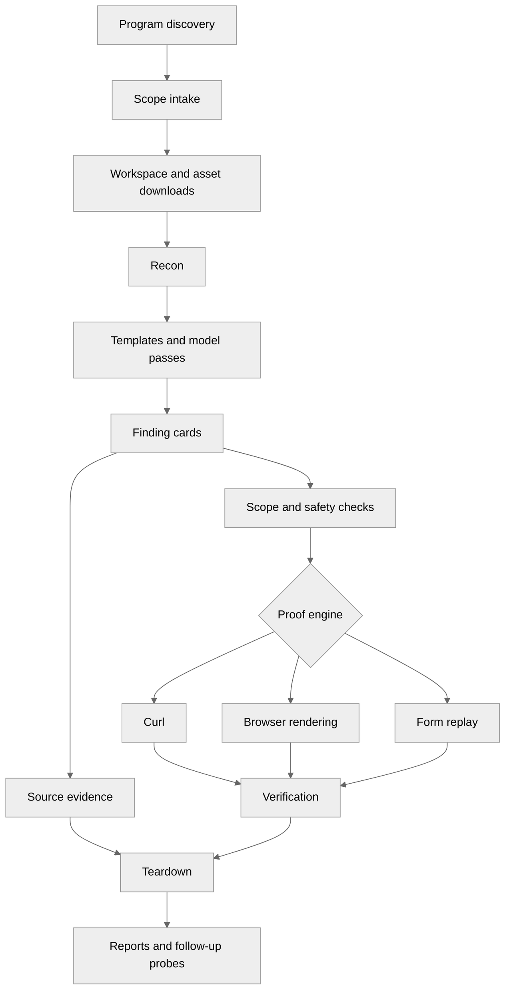

> **HISTORICAL EXPORT — dated Greptile review snapshot; superseded by subsequent refactors. Do not cite as current architecture.**

<!-- greptile_summary -->

<h2><a href="https://app.greptile.com/api/retrigger?id=80484364"><picture><source media="(prefers-color-scheme: dark)" srcset="https://greptile-static-assets.s3.amazonaws.com/badges/RetriggerDark.svg?v=2"><source media="(prefers-color-scheme: light)" srcset="https://greptile-static-assets.s3.amazonaws.com/badges/Retrigger.svg?v=2"></picture></a>Confidence Score: 0/5</h2>

**[High impact]** Adds 32 new Python modules for security research automation\.

This source tree is not safe to merge or use for unattended hunts until scope enforcement, proof replay, and the broken account, contract, model, and email paths are fixed.

<h2>Findings</h2>

1. &nbsp;&nbsp;**Form probes bypass safety checks** <a href="https://github.com/code-hunter-extreme/oracle/pull/2#discussion_r4267684598">▶</a>
2. &nbsp;&nbsp;**Browser probes leak account headers** <a href="https://github.com/code-hunter-extreme/oracle/pull/2#discussion_r4267684605">▶</a>
3. &nbsp;**Cross\-account probes never run** <a href="https://github.com/code-hunter-extreme/oracle/pull/2#discussion_r4267684615">▶</a>
4. &nbsp;**Unauthenticated checks get authenticated** <a href="https://github.com/code-hunter-extreme/oracle/pull/2#discussion_r4267684624">▶</a>
5. &nbsp;**Verdicts describe an unrun request** <a href="https://github.com/code-hunter-extreme/oracle/pull/2#discussion_r4267684634">▶</a>
6. &nbsp;**Teardown discards valid proofs** <a href="https://github.com/code-hunter-extreme/oracle/pull/2#discussion_r4267684644">▶</a>
7. &nbsp;**Object controls change unrelated inputs** <a href="https://github.com/code-hunter-extreme/oracle/pull/2#discussion_r4267684655">▶</a>
8. &nbsp;**Safe reflection looks like XSS** <a href="https://github.com/code-hunter-extreme/oracle/pull/2#discussion_r4267684667">▶</a>
9. &nbsp;**JavaScript\-only template crashes** <a href="https://github.com/code-hunter-extreme/oracle/pull/2#discussion_r4267684674">▶</a>
10. &nbsp;**Secret predictions reject real leaks** <a href="https://github.com/code-hunter-extreme/oracle/pull/2#discussion_r4267684703">▶</a>
11. &nbsp;**Contract findings fail scope checks** <a href="https://github.com/code-hunter-extreme/oracle/pull/2#discussion_r4267684710">▶</a>
12. &nbsp;**Contract downloads lose source paths** <a href="https://github.com/code-hunter-extreme/oracle/pull/2#discussion_r4267684718">▶</a>
13. &nbsp;**Replies address a thread ID** <a href="https://github.com/code-hunter-extreme/oracle/pull/2#discussion_r4267684728">▶</a>
14. &nbsp;**Email starts the wrong browser** <a href="https://github.com/code-hunter-extreme/oracle/pull/2#discussion_r4267684741">▶</a>
15. &nbsp;**Free\-only routing uses paid cache** <a href="https://github.com/code-hunter-extreme/oracle/pull/2#discussion_r4267684747">▶</a>
16. &nbsp;**Default cloud backends never run** <a href="https://github.com/code-hunter-extreme/oracle/pull/2#discussion_r4267684751">▶</a>
17. &nbsp;**Default hunts skip local generation** <a href="https://github.com/code-hunter-extreme/oracle/pull/2#discussion_r4267684765">▶</a>
18. &nbsp;&nbsp;**Plugin metadata grants live scope** <a href="https://github.com/code-hunter-extreme/oracle/pull/2#discussion_r4267684774">▶</a>
19. &nbsp;&nbsp;**Removed assets stay approved** <a href="https://github.com/code-hunter-extreme/oracle/pull/2#discussion_r4267684783">▶</a>

<details><summary>Fix with agent prompt</summary>

`````markdown
### Issue 1
oracle_harvest.py:1235-1247
`confirm_form_replay` still sends a POST after `validate_check` downgrades the check to GET for production. It also posts to the page's supplied `action` and follows redirects without checking scope. Pass the scope gate and mutation permission into this confirmer, and check every destination before sending a request.

**How this was verified:** An approved page's form action flows directly into an unrestricted POST, outside the checks applied to the original command.

### Issue 2
oracle_rendered.py:136-138
`rendered_reflection` attaches the account's `Authorization` and `Cookie` headers to the whole browser page. It then loads scripts, images, requests, and redirects without a scope filter. An approved target can reference an outside host and expose these headers there. Filter browser requests before sending them and attach credentials only to the approved origin.

**How this was verified:** Account headers reach `extra_http_headers`, while navigation has no request filter to stop target-controlled outside destinations.

### Issue 3
oracle_auth_session.py:514-526
`build_idor_probes` emits cards without `expected` or `assertion_a_source`. `verify_seams` rejects every generated probe for missing `expected` before it runs. Adding only that field would then hit the missing-source check. Emit complete cards with an observed Account A resource and a response prediction that proves cross-account access.

### Issue 4
oracle_hunter.py:3256-3268
When a researcher supplies credentials, `verify_seams` adds them to every check that lacks them. That undoes `strip-auth` follow-ups and authenticates templates meant to test access without a session. These probes no longer test the intended identity. Preserve deliberate credential omission on the card instead of treating every missing header as a request to add one.

### Issue 5
oracle_hunter.py:3179-3181
When safety mode changes a POST into GET, only the local `check` changes. The verifier still receives `s` with the original POST command and prediction. A GET response can therefore confirm a payload that was never sent, or hide a real POST-only issue. Record the actual request on the card and mark the original mutation claim untested when it is downgraded.

### Issue 6
oracle_hunter.py:3847-3860
`teardown_poc` replays every finding through `_run_check` and `verify_seam_card`, even when a different engine proved it:
- DOM-only XSS disappears from raw curl output.
- Two-step form probes lose their token setup.
- Executed source checks lack HTTP predictions.

These valid findings are then demoted. Replay and evaluate each finding through the same proof path that first confirmed it.

### Issue 7
oracle_hunter.py:3791-3793
`_swap_check_ids` replaces every digit in the URL, including API versions and encoded payloads. It then treats another matching response as proof that the finding is invalid. A real XSS reflection probe can change `%3C` to `%9C` while keeping its text marker, so the control still matches and the finding is demoted. Apply object-ID controls only to identified resource IDs and claims that depend on ownership.

### Issue 8
oracle_seam_templates.py:1412-1414
The XSS checks treat the presence of `oraclex1` or `oracledom7` as proof that script ran. Escaped HTML and `textContent` preserve those strings without running code. The payloads also call `alert` with an undefined variable rather than a quoted marker. Use a working execution marker and observe its execution; raw reflection should remain a candidate.

### Issue 9
oracle_seam_templates.py:903-906
`_t_beautiful_liar` adds `url` instead of `abs_url` in its JavaScript endpoint loop. When `fuzzed_paths.txt` is absent or empty, `url` has never been assigned. The template raises and loses every header-bypass candidate. Add `abs_url` to `seen` here.

```suggestion
        abs_url = _abs_url(ep, mat)
        if not abs_url or abs_url in seen:
            continue
        seen.add(abs_url)
```

### Issue 10
oracle_seam_templates.py:533-534
`_t_t1552` predicts only the secret's key name, but the verifier deliberately rejects short identifier-only markers for shipped secrets. Common keys such as `secret`, `password`, and `api_key` cannot confirm even when the bundle contains a real literal credential. Preserve enough assignment evidence or verify the recorded fingerprint rather than predicting only the key name.

### Issue 11
oracle_seam_templates_web3.py:462-467
`scan_web3_seams` sends a local Solidity filename to the host-based `ProgramScopeGate`. An absolute source path has no host, so normal hunt calls discard every generated Web3 card. The later `validate_check` also requires an HTTP URL for `slither` checks. Add a source-path scope check and a separate verification route for approved contract files.

### Issue 12
oracle_web3_recon.py:197-199
`fetch_sourcify` discards every source directory by using `Path(name).name`. Relative imports then point to files that no longer exist, and source files with the same basename overwrite each other. Preserve validated relative paths inside `sources` so multi-file contracts remain compilable and complete.

### Issue 13
oracle_email.py:1987-1990
`cmd_reply` uses the Gmail thread ID as the recipient and invents a subject from that ID. `send_via_chrome_clicks` opens a new compose window, so it types the thread ID into the To field rather than replying to the sender. Queued replies have the same invalid recipient. Use Gmail's Reply action or extract the actual sender, subject, and thread details before queuing or sending.

### Issue 14
oracle_email.py:266-273
The email bootstrap launches Firefox and accepts its BiDi server as ready, but inbox and send paths still require Chromium's `/json/list`, `/json`, and CDP WebSocket messages. On the default auto-launch path, Firefox starts successfully and those commands then fail. Either launch Chromium for these consumers or implement the Firefox protocol throughout.

### Issue 15
oracle_llm.py:110-111
The model cache returns its saved list before applying `allow_paid`. After one paid-enabled discovery, turning paid models off still admits cached paid IDs for up to an hour. `_models` can select them and charge the account. Apply the free-only filter on cache reads or separate caches by payment policy.

### Issue 16
oracle_llm.py:228-229
`Backend.fits` rejects a backend whenever `context_tokens` is unknown. If an installation uses the built-in settings, OpenRouter and NVIDIA both lack that value and are skipped even with valid keys. This contradicts the documented fallback to the provider's own limit check. Allow unknown limits to be tried or supply usable limits in the defaults.

### Issue 17
oracle_hunter.py:6492-6493
Local generation requires `no_cloud`, not the absence of an available cloud lane. With Ollama running, no cloud credentials, and the default command, `require_mindsets` accepts the requested lenses but neither engine submits work. The hunt later fails for missing lens output. Use local generation when cloud lanes are unavailable, or reject this setup before downloading and probing.

### Issue 18
oracle_bulk_download.py:764-767
`_fetch_patchstack_scopes` turns the plugin's WordPress homepage metadata into an eligible wildcard for the vendor's entire domain. A plugin homepage is not permission to test the vendor's live websites. This record reaches recon and the ordinary scope gate as if Patchstack granted that scope. Keep plugin downloads separate from live targets and require an explicit program grant before adding a vendor domain.

**How this was verified:** WordPress homepage metadata is converted directly into a bounty-eligible wildcard consumed by the hunt's scope gate.

---

For each issue above, determine whether it is valid and should be fixed. If so, fix it directly.
`````

(1 more issue omitted due to length limits.)

</details>

<h3>Summary</h3>

This review covers 32 newly added Python modules for bounty discovery, scope intake, recon, model routing, finding verification, contract analysis, and Gmail automation.

- Oracle turns bounty listings into a selected, scheduled hunt.
- Oracle gathers scoped target evidence for its hunt analysis.
- Oracle turns target evidence into candidate checks and finding cards.
- Oracle routes model requests through configurable backends.
- The email daemon reads Gmail and supports reviewed replies.

<details open><summary><h3>Diagram</h3></summary>


</details>

<!-- greptile_confidence_score:0 -->

<sub>Reviews (1) · Last reviewed commit: ["re-add core source for Greptile review (..."](https://github.com/code-hunter-extreme/oracle/commit/3a861f992f037488393fab91c2a1741a855d653f) · [Reviewed by Greptile](https://www.greptile.com/?utm_source=greptile_expert&utm_medium=github&utm_campaign=code_reviews&utm_content=code-hunter-extreme/oracle)</sub>
