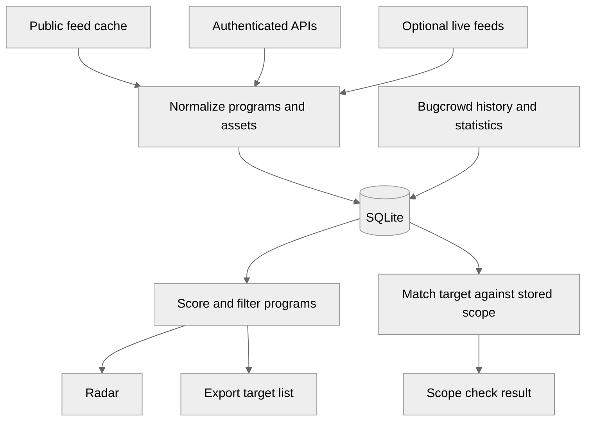

> **HISTORICAL EXPORT — dated Greptile review snapshot; superseded by subsequent refactors. Do not cite as current architecture.**

<!-- greptile_summary -->

<h2><a href="https://app.greptile.com/api/retrigger?id=80484841"><picture><source media="(prefers-color-scheme: dark)" srcset="https://greptile-static-assets.s3.amazonaws.com/badges/RetriggerDark.svg?v=2"><source media="(prefers-color-scheme: light)" srcset="https://greptile-static-assets.s3.amazonaws.com/badges/Retrigger.svg?v=2"></picture></a>Confidence Score: 0/5</h2>

**[Low impact]** New standalone Python script added\.

The source needs fixes before use because scope checks can approve targets that are excluded, withdrawn, or outside the original rule.

<h2>Findings</h2>

1. &nbsp;**Limited scope becomes host\-wide** <a href="https://github.com/code-hunter-extreme/Scan4Me/pull/1#discussion_r4267653130">▶</a>
2. &nbsp;**Excluded hosts appear authorized** <a href="https://github.com/code-hunter-extreme/Scan4Me/pull/1#discussion_r4267653143">▶</a>
3. &nbsp;**Ineligible assets remain targets** <a href="https://github.com/code-hunter-extreme/Scan4Me/pull/1#discussion_r4267653155">▶</a>
4. &nbsp;**Withdrawn programs remain active** <a href="https://github.com/code-hunter-extreme/Scan4Me/pull/1#discussion_r4267653194">▶</a>
5. &nbsp;**Removed scope inflates rankings** <a href="https://github.com/code-hunter-extreme/Scan4Me/pull/1#discussion_r4267653202">▶</a>
6. &nbsp;**Offline sync contacts APIs** <a href="https://github.com/code-hunter-extreme/Scan4Me/pull/1#discussion_r4267653234">▶</a>
7. &nbsp;**Strict filters admit undated targets** <a href="https://github.com/code-hunter-extreme/Scan4Me/pull/1#discussion_r4267653257">▶</a>
8. &nbsp;**Old databases break read commands** <a href="https://github.com/code-hunter-extreme/Scan4Me/pull/1#discussion_r4267653310">▶</a>
9. &nbsp;**Old feeds look fresh** <a href="https://github.com/code-hunter-extreme/Scan4Me/pull/1#discussion_r4267653250">▶</a>
10. &nbsp;**Disabled kinds stay enabled** <a href="https://github.com/code-hunter-extreme/Scan4Me/pull/1#discussion_r4267653272">▶</a>
11. &nbsp;**Triage off still filters** <a href="https://github.com/code-hunter-extreme/Scan4Me/pull/1#discussion_r4267653283">▶</a>
12. &nbsp;**URL history loses dates** <a href="https://github.com/code-hunter-extreme/Scan4Me/pull/1#discussion_r4267653295">▶</a>
13. &nbsp;**Export includes status text** <a href="https://github.com/code-hunter-extreme/Scan4Me/pull/1#discussion_r4267653320">▶</a>
14. &nbsp;**Partial fetches look complete** <a href="https://github.com/code-hunter-extreme/Scan4Me/pull/1#discussion_r4267653334">▶</a>
15. &nbsp;**Authenticated sync drops restrictions** <a href="https://github.com/code-hunter-extreme/Scan4Me/pull/1#discussion_r4267653349">▶</a>

<details><summary>Fix with agent prompt</summary>

`````markdown
### Issue 1
scan4me.py:885
`canonicalize_asset` turns a repository rule such as `https://github.com/acme/project` into `github.com`. `cmd_check` then treats every URL on that host as authorized, and `cmd_export` emits the shared host as a target. Preserve repository and URL limits in storage. Only derive bare hosts where they cannot be mistaken for authorization.

### Issue 2
scan4me.py:3134-3138
`cmd_check` never checks `oos_assets`. With `*.example.com` in scope and `admin.example.com` explicitly out of scope, it still prints `AUTHORIZED IN-SCOPE` for `admin.example.com`. Apply live exclusions from the same program before accepting a match.

### Issue 3
scan4me.py:3172-3173
`cmd_check` and `cmd_export` ignore stored eligibility flags. The public-feed path keeps assets with `eligible_for_submission=0`, yet checking them prints authorization and exporting a paid program includes them. Assets with `eligible_for_bounty=0` also enter the paid target list. Require submission eligibility for checks and exports, and bounty eligibility when selecting paid targets.

### Issue 4
scan4me.py:1672-1674
`sync_data` updates only programs returned by a feed. If a program disappears after closing or withdrawing its scope, its old assets remain live indefinitely. Later checks still report authorization and exports still include them. After a complete successful fetch, mark missing programs and their assets inactive. Keep failed or partial fetches separate.

### Issue 5
scan4me.py:2465
`evaluate_targets` counts deleted assets because its `LEFT JOIN` lacks `deleted_timestamp=0`. When scope shrinks, old assets and wildcards still raise the score and satisfy `min_in_scope_assets`. A program with no live assets can take a top export slot while exporting nothing. Put the live-asset condition in the join.

```suggestion
        "LEFT JOIN assets a ON p.id = a.program_id AND a.deleted_timestamp=0 "
```

### Issue 6
scan4me.py:1650-1657
`sync --offline` still calls authenticated APIs whenever credentials are configured. `h1_auth_used`, and the equivalent conditions for the other three platforms, do not check `refresh`. Offline runs can wait for network timeouts or replace cached scope with live responses. Use cached data without network requests when `refresh=False`.

### Issue 7
scan4me.py:2626-2631
`--new-companies` and `--new-assets` do not enforce their promised official Bugcrowd dates:
- The company filter admits other platforms using observation dates.
- The asset filter admits other platforms and undated Bugcrowd programs, even with zero new assets.

In strict mode, require Bugcrowd and a recent official date. Keep observation-based guesses in scoring mode only.

### Issue 8
scan4me.py:2935
`cmd_filter` and `cmd_export` call `evaluate_targets` before `ensure_schema`. On an older database missing the new columns, ranking raises a SQLite error before the later migration can run. Move schema setup ahead of ranking in both CLI paths. The library function can keep its existing query-count contract.

### Issue 9
scan4me.py:2283
`last_sync_ts` is replaced with the current time even after a failed pull or an offline import. `feed_provenance` uses that value as feed age, so reimporting a week-old snapshot makes it appear fresh and clears `stale`. Track the last successful refresh separately and use it for feed age.

### Issue 10
scan4me.py:2474
Setting both `program_kind.web2` and `program_kind.web3` to false returns every kind instead of no targets. An empty `allowed_kinds` skips the SQL filter. Return an empty result, or reject this configuration explicitly.

```suggestion
    if not allowed_kinds:
        return []
    if len(allowed_kinds) < 2:
```

### Issue 11
scan4me.py:2577-2578
`fast_triage.enabled=False` disables the HackerOne filters but leaves both Bugcrowd validation filters active. With the default `max_validation_days=14`, disabling triage still drops a Bugcrowd program reporting 20 days. Gate both validation filters on `enabled` as well.

### Issue 12
scan4me.py:1133
If a changelog URI is `https://app.example.com/` and its name does not separately supply the host, `bugcrowd_scope_aliases` cannot match the stored `app.example.com`. It keeps the scheme and path, while stored assets have been reduced to hosts. The official date stays missing or is cleared. Apply the same identifier rules to both sides of the history lookup.

### Issue 13
scan4me.py:462-465
`load_config` prints its template notice to stdout. When `config.json` is absent, the documented export pipeline receives this notice before any target, so the output is not a clean target list. Send configuration notices and warnings to stderr.

### Issue 14
scan4me.py:180-183
Authenticated fetchers silently return a partial list when page two or later fails. `_platform_status` then records any nonempty result as `ok`, hiding the missing programs. Report the failed page and carry a partial-fetch status through to the stored feed status.

### Issue 15
scan4me.py:211-214
`_fetch_h1_authenticated` drops `eligible_for_bounty`, `instruction`, and `max_severity` from each accepted scope entry. An asset that accepts submissions but does not pay bounties is then stored with `eligible_for_bounty=1`, and its restrictions disappear. Preserve these fields alongside the identifier and type.

```suggestion
                            {
                                "asset_identifier": s.get("asset_identifier", ""),
                                "asset_type": s.get("asset_type", "URL"),
                                "eligible_for_bounty": s.get("eligible_for_bounty", True),
                                "eligible_for_submission": s.get("eligible_for_submission", True),
                                "instruction": s.get("instruction") or "",
                                "max_severity": s.get("max_severity") or "",
                            }
```

---

For each issue above, determine whether it is valid and should be fixed. If so, fix it directly.
`````

</details>

<h3>Summary</h3>

Adds `scan4me.py` with feed sync, SQLite history, Bugcrowd enrichment, target ranking, scope checks, and exports.
- Scan4Me brings program feeds into a local database.
- Scope checks compare targets with normalized, active assets.
- The radar ranks programs using published signals and scope size.
- Researchers can see feed status and export ranked assets from the command line.

<details open><summary><h3>Diagram</h3></summary>


</details>

<!-- greptile_confidence_score:0 -->

<sub>Reviews (1) · Last reviewed commit: ["re-add source for Greptile review (not f..."](https://github.com/code-hunter-extreme/scan4me/commit/6e43e565ddd10f5c27be5ce3f354239ffa4d2543) · [Reviewed by Greptile](https://www.greptile.com/?utm_source=greptile_expert&utm_medium=github&utm_campaign=code_reviews&utm_content=code-hunter-extreme/scan4me)</sub>
