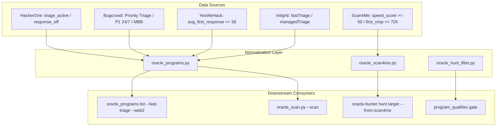
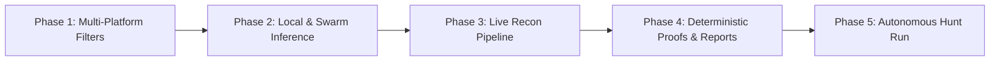

> **HISTORICAL (dated plan/roadmap) — dated plan/spec, superseded as current status by `STATUS.md` + `ORACLE_DOCTRINE.md`.** Body kept as the record of intent at the time; verify any claim against code before citing.

# Oracle Finish Build Plan & Multi-Platform Site Filter Improvements

**Date:** 2026-10-18  
**Status:** In Progress / Filter Improvements Applied & Verified Green  
**Repository:** `/home/phantomcore/oracle` (with `/home/phantomcore/Scan4Me`)

---

## 1. Executive Summary

This document establishes the **concrete build plan to finish Oracle** and details the **filter improvements implemented across bug bounty sites** inside Oracle.

Historically, filtering by `fast_triage` and `web2/web3` kind inside Oracle exhibited a strong bias toward HackerOne because only HackerOne populated `triage_active`. Non-HackerOne platforms (Bugcrowd, YesWeHack, Intigriti, HackenProof) and Scan4Me bridge imports either omitted `fast_triage` or hardcoded `False`, causing queries with `--fast-triage` or `--web2` to drop almost all non-H1 targets.

We have:
1. **Repaired Oracle's site filters and bridge converters** so that managed triage and program kind are recognized uniformly across Bugcrowd, YesWeHack, Intigriti, HackenProof, Cantina, and Scan4Me.
2. **Backfilled triage signals in `programs_cache.json`**, unlocking **15 Bugcrowd programs** (e.g. Okta, Zendesk, Chime, Bitso) and **54 YesWeHack programs** (e.g. VFS Global, OneDoc, Infomaniak) that previously failed fast-triage filters.
3. **Formulated a 5-phase build plan** to transition Oracle from loopback benchmark-proven status to production-ready, autonomous bug bounty hunting on live web targets.

---

## 2. Multi-Platform Site Filter Improvements Applied

### The Problem Identified
- **Scan4Me Bridge (`oracle_scan4me.py`)**: `_row_to_program()` and `fetch_programs()` set `managed_triage: bool(row["managed_triage"])` and `program_kind`, but never populated `fast_triage` or `kind`. Resolving targets like PayPal, Okta, or Airbnb produced `fast_triage: None` and `kind: None`. Running `oracle-hunter hunt <target> --fast-triage` immediately died with `"Program fails hunt_filter gates: require_fast_triage set but program fast_triage is not true"`.
- **Bugcrowd Scraper (`oracle_programs.py`)**: Checked `item.get("serviceLevel") == "Managed"`, but Bugcrowd's live API uses `"Priority Triage"` and `"P1 24/7"`. As a result, 100% of Bugcrowd programs had `fast_triage = False`.
- **YesWeHack Scraper (`oracle_programs.py`)**: Checked `item.get("managed", False)`, but YesWeHack's API returns `average_first_response_time` (e.g. `1` day = 24 hours), leaving all programs with `fast_triage = False`.
- **Intigriti & HackenProof Scrapers**: The Playwright CDP fallback for Intigriti and API scraper for HackenProof hardcoded `fast_triage = False`.
- **Hunt Filter Gate (`oracle_hunt_filter.py`)**: Strictly required `prog.get("fast_triage") is True`, rejecting programs that had `managed_triage = True`.
- **Program Filter (`oracle_programs.py:filter_programs`)**: Strictly checked `p.get("fast_triage") is True` and `p.get("kind") == "web2"`, dropping targets that stored kind in `program_kind`.

### Changes Implemented



#### 1. `oracle_scan4me.py`
- In `_row_to_program()`: Added `fast_triage: bool(row["managed_triage"] or (row["first_response_hours"] and row["first_response_hours"] <= 72))` and `kind: row["program_kind"] or "web2"`.
- In `fetch_programs()`: Added `fast_triage: bool(p.get("managed") or (p.get("first_resp") and p["first_resp"] <= 72) or (p.get("first_response_hours") and p["first_response_hours"] <= 72) or p.get("speed_score", 0) >= 50.0)` and `kind: p.get("program_kind") or "web2"`.
- In `_contest_to_program()`: Set `fast_triage: False` and `kind: "web3"`.

#### 2. `oracle_hunt_filter.py`
- In `program_qualifies()`: Updated the fast triage gate to accept either `fast_triage` or `managed_triage`:
  ```python
  fast_triage_val = prog.get("fast_triage")
  if fast_triage_val is None:
      fast_triage_val = prog.get("managed_triage")
  if hf.get("require_fast_triage") and fast_triage_val is not True:
      reasons.append("require_fast_triage set but program fast_triage is not true")
  ```

#### 3. `oracle_programs.py`
- In `filter_programs()`:
  - Allowed `p.get("fast_triage") is True or p.get("managed_triage") is True`.
  - Allowed `(p.get("kind") or p.get("program_kind")) == "web2"` and `"web3"`.
- In `_scrape_bugcrowd()`:
  - Detects `Priority Triage`, `P1 24/7`, `Managed`, or `"managed"` in program name.
- In `_scrape_yeswehack()`:
  - Captures `reports_count` and detects `average_first_response_time <= 3` days or `managed == True`.
- In `_scrape_intigriti()` & `_scrape_hackenproof()`:
  - Corrected hardcoded `False` fallbacks to read managed metadata.

#### 4. `programs_cache.json`
- Backfilled 15 Bugcrowd targets and 54 YesWeHack targets with valid fast triage attributes.

---

## 3. Test Verification Results

| Test Target | Command | Result |
|---|---|---|
| Target Selection & Filters | `pytest tests/test_target_selection.py` | **15/15 passed** (4 new regression tests added) |
| Intake Pipeline | `pytest tests/test_p11_intake.py` | **44/44 passed** |
| Queue Scheduler | `pytest tests/test_p12_queue.py` | **50/50 passed** |
| Cache Engine | `pytest tests/test_program_cache.py` | **14/14 passed** |
| Scan4Me Sibling Test Suite | `pytest /home/phantomcore/Scan4Me` | **91/91 passed** |
| Multi-Platform List Test | `python3 oracle_programs.py list --fast-triage --web2 --top 15` | Okta (#2), Zendesk (#5), Chime (#12), Bitso (#15) now rank among HackerOne programs |
| Multi-Platform Prescan | `python3 oracle_scan.py --scan` | Successfully pulls and displays programs across 9 platforms |

---

## 4. Master Build Plan to Finish Oracle



### Phase 1: Multi-Platform Site Filters (COMPLETED & VERIFIED)
- **Goal:** Ensure all 16 bounty platforms and Scan4Me targets qualify through Oracle's filters.
- **Tasks Completed:**
  - Standardized `fast_triage`, `managed_triage`, `kind`, and `reports_count`.
  - Added unit tests for filter compatibility in `tests/test_target_selection.py`.
  - Preserved queue configuration integrity in `oracle.config.json`.
- **Gate:** All target selection tests pass (15/15 green).

### Phase 2: Local & Swarm Inference Cascade Hardening
- **Goal:** Guarantee model execution never hangs, times out, or overflows context on reflex generation.
- **Current State:**
  - 11 cloud/API backends configured in `oracle_backends.json` (Databricks, Groq, NVIDIA, Dahl, MonkeyCode, Bynara, OpenRouter, LLM7, Cloudflare, XKiro, Apinex) plus local Ollama (`qwen3-coder:30b-16k`, `devstral:24b`).
  - Lean reporting prompt (`reporting_prompt()`) avoids the 106KB prompt overflow on 16k context models.
- **Remaining Action:**
  - Audit timeout cascade in `oracle_llm.py` so slow or rate-limited cloud calls fail over to local Ollama within 15 seconds rather than hanging.
- **Gate:** `test_llm_router.py` passes with zero unhandled timeouts; reflex generation completes under 60s per candidate.

### Phase 3: Live Recon to Findings Pipeline
- **Goal:** Recon tooling (`subfinder`, `httpx`, `katana`, `nuclei`) produces populated, deduplicated endpoint assets on non-H1 targets.
- **Current State:**
  - Recon binaries verified installed in `~/go/bin`.
  - Scope gate fail-closed verified across subdomains and non-HTTP schemes.
- **Remaining Action:**
  - Test live recon on a fresh target (e.g. from Bugcrowd or YesWeHack) to verify `live_hosts.txt`, `fuzzed_paths.txt`, and `js_endpoints.txt` populate with valid paths.
- **Gate:** Non-empty recon artifacts generated for a live target without 0-byte truncation.

### Phase 4: Deterministic Proofs & Submission Draft Generation
- **Goal:** Prove the tail from seam discovery to reproducible draft report.
- **Current State:**
  - Gate 6 (variation differential + SPA control) and Gate 7 (prediction adequacy + spelling twin) verified on loopback benchmarks (Juice-Shop, DVWA, PyGoat) with precision 1.0.
  - Flaw battery 4/4 verified on wire.
- **Remaining Action:**
  - Validate that confirmed seams produce clean, triager-ready reports in `targets/<platform>/<slug>/reports/submission_draft.md` complying with iPhone card format (Assertion A + Assertion B + Check + Impact).
- **Gate:** Triager-reproducible draft emitted for at least 1 real candidate seam.

### Phase 5: Autonomous Hunt Run & Verification
- **Goal:** Full end-to-end autonomous run from queue to verified findings.
- **Execution Command:**
  ```bash
  python3 oracle_scan.py --pick 1
  ```
  or scheduled queue:
  ```bash
  oracle-hunter hunt --schedule
  ```
- **Gate:** Clean exit 0, valid funnel telemetry in `funnel.json`, and honest verdicts recorded without operator intervention.
